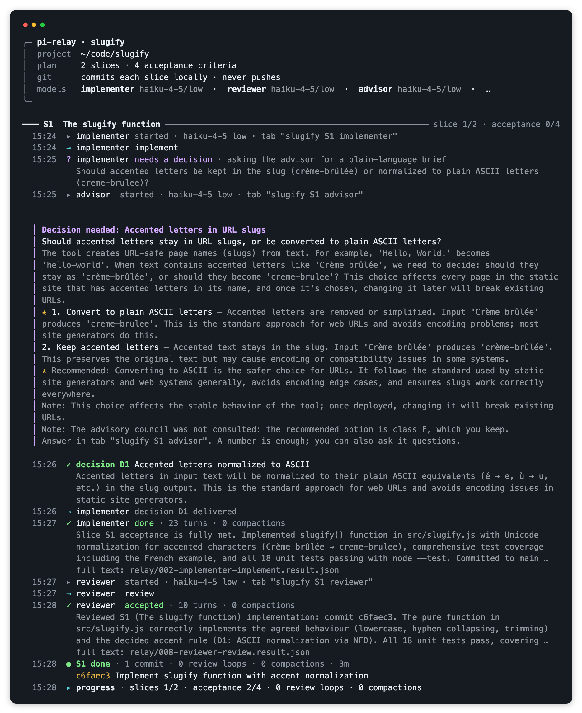
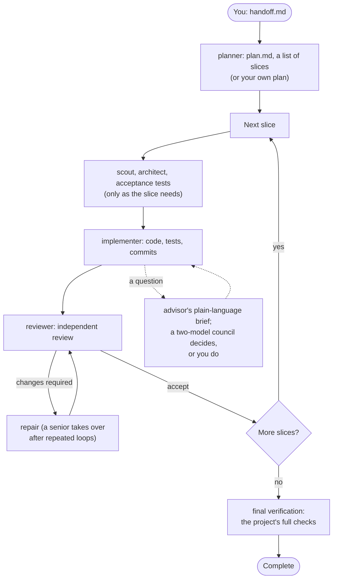

# Pi setup

Personal configuration for the [Pi coding agent](https://github.com/earendil-works/pi): global
instructions, prompt templates, a skill, extensions, and `pi-relay`, a script that drives Pi workers in
Herdr tabs one slice at a time.

This checkout is where the setup is changed and committed. `scripts/install.mjs` copies `agent/` into
`~/.pi/agent`, which every Pi session and relay run uses.

## pi-relay at a glance

You write a handoff (the outcome, the scope, the authority) in a conversation with `/handoff`; the relay, a
deterministic script, then runs the work through fresh Pi workers in Herdr tabs, one slice at a time, and asks
you only what it cannot settle. Its [README](agent/relay/README.md#how-it-works) shows the whole loop in six
diagrams.

### An example

A small tool, [`slugify`](docs/example/handoff.md) (`"Hello, World!"` → `hello-world`), from a real run. The
handoff leaves one choice open on purpose (accented letters), so the run asks for a decision:

<details>
<summary><code>handoff.md</code> (excerpt)</summary>

```markdown
## Outcome
A Node.js tool that turns text into a URL slug: `slugify "Hello, World!"` prints `hello-world`. It is used by
a static site generator to name pages, so the same input must always give the same slug.

## Agreed behaviour
- Lower case; runs of anything other than letters and digits become one `-`; no `-` at either end.
- Empty input (or input with no letters or digits) prints nothing and exits with status 1.

## Open question
Accented letters (`Crème brûlée`): keep them (`crème-brûlée`) or reduce them to plain letters
(`creme-brulee`). The implementer asks for a decision before writing that part.

## Acceptance
- `node --test` passes, covering the agreed behaviour, the decided accent rule and empty input.
- `echo "Hello, World!" | node bin/slugify.js` prints `hello-world`.

## Authority
Commit locally on the current branch; never push. No new dependencies.
```
</details>

<details>
<summary><code>plan.md</code></summary>

```markdown
# Plan: slugify

## S1: The slugify function
Needs: none
Acceptance:
- `slugify` in `src/slugify.js` implements the agreed behaviour and the decided accent rule.
- Unit tests cover them and empty input; `node --test` passes.

## S2: The command
Needs: none
Acceptance:
- `bin/slugify.js` reads its arguments, or standard input when there are none, and prints the slug.
- Empty input prints nothing and exits with status 1; a test covers both paths.
```
</details>

The console during the first slice: the question, the advisor's brief you answer (here the advisor judged it
yours, since a published address format is hard to change), your decision, then implementation and review.



### The loop



## Contents

| Path | What it is |
|---|---|
| `agent/APPEND_SYSTEM.md` | Instructions appended to every session's system prompt |
| `agent/settings.json`, `agent/models.json` | Pi settings: packages, enabled models, defaults, model overrides |
| `agent/prompts/` | Prompt templates (`/discussion`, `/handoff`, `/plan`, `/implement`, `/review`, `/deep-review`, …); `/advise` and `/council` are used by the relay only |
| `agent/skills/agent-work/` | Conventions for `.agents_work/<topic>/` folders and role records |
| `agent/extensions/` | Herdr agent-state and Moshi notification extensions, plus package settings |
| `agent/relay/` | `pi-relay`: script, role and model configuration, and its [README](agent/relay/README.md) |
| `docs/` | The example handoff, plan and console screenshot shown above (not installed) |
| `scripts/install.mjs` | Installs `agent/` into `~/.pi/agent`, refusing to overwrite files changed in place |
| `test/` | Tests (`npm test`) |

## Install

Requires Pi, Node.js 22 or later, and [Herdr](https://herdr.dev) for the relay.

```sh
git clone git@github.com:drousselhq/pi-setup.git ~/Documents/devel/pi-setup
cd ~/Documents/devel/pi-setup
node scripts/install.mjs --check     # what would change
node scripts/install.mjs             # install into ~/.pi/agent
ln -s ~/.pi/agent/relay/pi-relay.mjs ~/.local/bin/pi-relay   # once: put pi-relay on PATH
```

The installer records what it installed in `~/.pi/agent/.pi-setup-install.json`. If an installed file
was changed in place since then (by hand, by an agent, or by Pi itself, which updates `settings.json`),
it installs nothing and shows the difference. Keep the installed version with `--pull FILE` and commit
it, or replace it with `--force FILE`.

Not included:
- **Login:** run `/login` in Pi (stored in `~/.pi/agent/auth.json`).
- **Herdr skill:** `~/.pi/agent/skills/herdr` is a link to `~/.agents/skills/herdr`, installed by Herdr.
  Recreate it with `ln -s ../../../.agents/skills/herdr ~/.pi/agent/skills/herdr`.
- **`pi-quotas`:** `settings.json` loads it from a local checkout (`../../Documents/devel/pi-quotas`,
  relative to `~/.pi/agent`). Clone it there, or change the entry to its npm package.

## Working on it

See [CONTRIBUTING.md](CONTRIBUTING.md).

## License

MIT: see [LICENSE](LICENSE).
